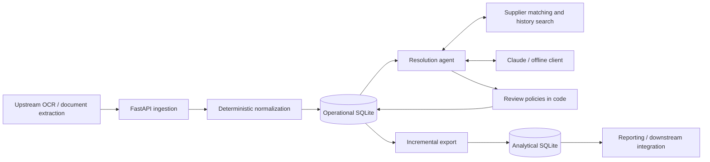

# LedgerRoute

**Auditable invoice classification and supplier resolution for finance workflows.**

LedgerRoute turns invoice fields extracted by an upstream OCR system into consistent supplier identities, spend categories, business units, and review decisions. It combines deterministic data validation with a tool-using language model, then applies business rules in code before publishing the result.

The service sits between document extraction and downstream accounting, procurement, or reporting systems. Each resolution preserves the model's proposal, the evidence returned by its tools, and the rules that shaped the final decision.

## Capabilities

- **Normalize inconsistent inputs:** parse dates and monetary amounts, standardize identifiers, and surface missing or unreliable fields as quality flags.
- **Resolve supplier identity:** match tax IDs and known aliases against a canonical supplier catalog, with similarity matches available as supporting evidence.
- **Classify spend with context:** use historical resolutions to propose categories and business units from controlled catalogs.
- **Apply review policies:** route new suppliers, conflicting evidence, and low-confidence cases to `needs_review` through deterministic rules.
- **Preserve a decision trail:** retain raw and normalized inputs, every resolution attempt, tool calls, model output, and applied rules.
- **Export incrementally:** maintain a separate analytical store with resolution history and a view of the latest exported result per invoice.

## Architecture



OCR runs upstream. LedgerRoute receives structured JSON and provides a resolution API; payment execution and the human review workflow belong to the integrating system. The `auto_approve` value refers to a classification decision.

See [system design](docs/design.md) for the agent protocol, evidence rules, storage model, and failure handling.

## Quick start

Python 3.12 or newer and Git are required. Run the commands from the repository root. The default configuration uses an offline client, so no API key is needed.

### Windows PowerShell

```powershell
git clone https://github.com/Noahzaidi/ledgerroute.git
cd ledgerroute
py -3.12 -m venv .venv
.venv\Scripts\python -m pip install -e ".[dev]"
if (-not (Test-Path .env)) { Copy-Item .env.example .env }
.venv\Scripts\python -m uvicorn app.main:create_app --factory
```

### macOS / Linux

```bash
git clone https://github.com/Noahzaidi/ledgerroute.git
cd ledgerroute
python3.12 -m venv .venv
.venv/bin/python -m pip install -e ".[dev]"
[ -f .env ] || cp .env.example .env
.venv/bin/python -m uvicorn app.main:create_app --factory
```

For Git Bash on Windows, use `.venv/Scripts/python` in place of `.venv/bin/python`.

Open [interactive API documentation](http://127.0.0.1:8000/docs). Startup loads the reference catalog and historical resolutions from `data/`; import new invoices separately.

In another terminal, import the bundled synthetic invoices, resolve an ambiguous supplier, and export the result:

```powershell
Invoke-RestMethod -Method Post http://127.0.0.1:8000/invoices/import -InFile data\new_post_ocr_inputs.json -ContentType application/json
Invoke-RestMethod -Method Post http://127.0.0.1:8000/invoices/doc_new_010/resolve | ConvertTo-Json -Depth 12
Invoke-RestMethod -Method Post http://127.0.0.1:8000/exports/run
```

Or use curl on macOS / Linux / Git Bash (`curl.exe` in PowerShell):

```bash
curl -sS -X POST http://127.0.0.1:8000/invoices/import -H "Content-Type: application/json" --data-binary @data/new_post_ocr_inputs.json
curl -sS -X POST http://127.0.0.1:8000/invoices/doc_new_010/resolve
curl -sS -X POST http://127.0.0.1:8000/exports/run
```

The ambiguous Amazon input receives `needs_review` with rules `RR1`, `RR2`, and `RR4`. Export includes resolved invoices awaiting review, so consumers must filter on `review_decision` for their own workflow.

### Run the sample pipeline

```powershell
.venv\Scripts\python scripts\run_sample.py
```

On macOS / Linux, use `.venv/bin/python scripts/run_sample.py`. The runner imports and resolves all 15 synthetic inputs, prints the decisions and a tool trace, and verifies incremental export. It uses temporary databases and selects the offline client by default, independently of `.env`.

## Configuration

Copy [`.env.example`](.env.example) to `.env` for local development, or supply environment variables directly.

| Variable | Default | Purpose |
| --- | --- | --- |
| `LLM_PROVIDER` | Required; template uses `fake` | `fake` for offline integration or `anthropic` for Claude. Startup fails if the provider is unspecified. |
| `ANTHROPIC_API_KEY` | Unset | Required for the Anthropic provider. |
| `ANTHROPIC_MODEL` | `claude-opus-5-5` | Model identifier; select one available to your account that supports the configured structured output and effort settings. |
| `ANTHROPIC_EFFORT` | `medium` | Reasoning effort: `low`, `medium`, `high`, `xhigh`, or `max`. |
| `DATA_DIR` | Repository `data/` | Directory containing `reference_data.json` and `historical_resolutions.json`. |
| `OPERATIONAL_DB_PATH` | Repository `var/operational.db` | Operational SQLite file. |
| `ANALYTICS_DB_PATH` | Repository `var/analytics.db` | Analytical SQLite file. |
| `LOG_LEVEL` | `INFO` | Python logging level. |

To use Claude, set `LLM_PROVIDER=anthropic` and supply `ANTHROPIC_API_KEY`. Restart the server after changing settings. The sample runner requires an explicit `--provider anthropic` to make external model calls. Those calls use the provider's billed API.

`GET /health` reports the configured provider and model. It is a liveness endpoint; it does not verify provider credentials or availability.

## API

| Method | Path | Behavior |
| --- | --- | --- |
| `GET` | `/health` | Service status and configured model provider. |
| `POST` | `/invoices` | Validate, normalize, and store one invoice. Returns `201`, `409` for an existing document ID, or `422` for an invalid payload. |
| `POST` | `/invoices/import` | Import a JSON array and report created, duplicate, and invalid items. |
| `GET` | `/invoices/{document_id}` | Retrieve the stored invoice and latest resolution with its trace. |
| `POST` | `/invoices/{document_id}/resolve` | Run resolution and policy checks. Each call creates a new attempt. |
| `POST` | `/exports/run` | Export resolved records whose current resolution has not yet been exported. |

`document_id` is the ingestion idempotency key. A resolution request can return HTTP `200` with `status="failed"`; integrations must inspect the processing status and `resolution.error`. `resolved` means processing completed, while `review_decision` determines the next business action.

The [data guide](data/README.md) describes the input contract and synthetic fixtures. OpenAPI schemas are available at `/openapi.json`.

## Deployment

A Docker image can run the service with persistent SQLite storage:

```bash
docker build -t ledgerroute:local .
docker volume create ledgerroute-data
docker run --rm --name ledgerroute --env-file .env -p 127.0.0.1:8000:8000 -v ledgerroute-data:/srv/ledgerroute/var ledgerroute:local
```

The image runs as an unprivileged user and includes a liveness check. Use [the deployment guide](docs/deployment.md) to configure organization-specific reference data, network access, backups, and operational controls.

The current release uses synchronous resolution and SQLite. Company deployments need an authenticated gateway, serialized resolution/export scheduling, a human review integration, and an agreed data retention policy. Multi-instance processing and horizontal scale require changes to the storage and job orchestration layers. These boundaries are documented so integrations can be planned against the behavior that is implemented.

## Development

```powershell
.venv\Scripts\python -m pytest
.venv\Scripts\python -m ruff format --check app tests scripts
.venv\Scripts\python -m ruff check app tests scripts
.venv\Scripts\python -m mypy app
```

Use `.venv/bin/python` on macOS / Linux. Tests use isolated databases and offline or stubbed model clients. GitHub Actions runs the same checks on Windows and Linux with Python 3.12, plus the offline sample pipeline.

See [contribution guidelines](CONTRIBUTING.md), [security guidance](SECURITY.md), and the [roadmap](docs/roadmap.md).

## Repository layout

```text
app/                 API, normalization, agent, review policies, storage, and export
data/                Synthetic invoices, historical fixtures, and reference catalogs
docs/                System design, deployment guidance, roadmap, and release steps
scripts/             Sample pipeline and source release packaging
tests/               Unit and integration tests
.github/workflows/   Automated checks
Dockerfile           Service container
```

## License

[MIT](LICENSE).
