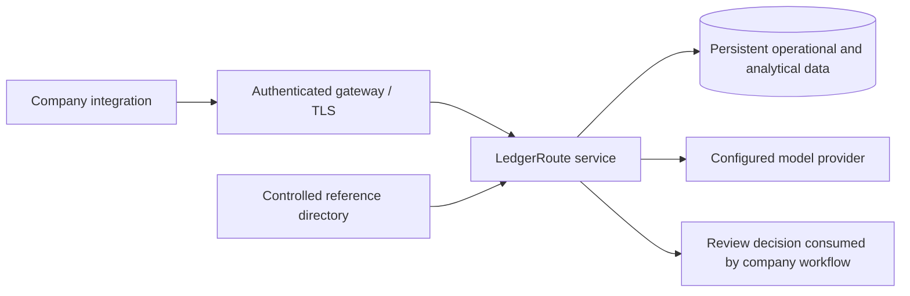

# Deployment and operations

LedgerRoute is an API service intended to integrate with an organization's existing document extraction, finance workflow, and reporting systems. The current storage backend is SQLite, and resolution runs synchronously within an HTTP request.

## Service topology

Use one service instance with a persistent local volume and a scheduler that serializes resolution and export. A single Uvicorn worker still accepts concurrent requests; enforce serialization in the calling workflow or a gateway. A scheduler or API gateway can also limit invoice imports and model request volume.



The application has no built-in authentication, authorization, tenant isolation, or rate limiting. Keep it on a private network behind an authenticated gateway, restrict access to `/docs` and `/openapi.json` as appropriate, and terminate TLS at the gateway. Treat all company data passed to the API as accessible to any caller allowed through that gateway.

## Container

Build from the repository root:

```bash
docker build -t ledgerroute:local .
docker volume create ledgerroute-data
docker run --rm --name ledgerroute --env-file .env -p 127.0.0.1:8000:8000 -v ledgerroute-data:/srv/ledgerroute/var ledgerroute:local
```

The image uses Python 3.12 and an unprivileged application user. It sets database paths under `/srv/ledgerroute/var` and reads bundled reference files from `/srv/ledgerroute/data`. The host port is bound to loopback in this example. Route company access through your controlled gateway.

Pass credentials through your deployment platform's secret management or environment injection. `.env` is a local convenience and is excluded from both Git and the Docker build context. Do not bake credentials into an image.

The container's liveness check requests `/health`. This confirms that the HTTP process responds; it does not check the model API, credentials, database write access, or end-to-end readiness.

## Company catalogs and history

Create a controlled directory containing:

- `reference_data.json`: canonical suppliers and aliases, allowed categories and business units, country hints, and model-facing review policy descriptions.
- `historical_resolutions.json`: approved historical records in the shipped schema, or `[]` when no history is available.

Set `DATA_DIR` to that directory. In a container, mount it read-only at `/srv/ledgerroute/data` or use another absolute path and override `DATA_DIR`. Restart after changes: reference data is loaded into memory at startup.

Use a fresh operational database for the initial company deployment so synthetic history does not enter company decisions. Startup seeding inserts previously unseen `history_id` values; it does not replace existing rows or delete rows absent from the input file. Historical corrections require controlled database maintenance until a managed feedback path is available.

## Model and review integration

Select `LLM_PROVIDER=anthropic`, inject `ANTHROPIC_API_KEY`, and set a model supported by your account and compatible with the configured output schema and reasoning effort. Verify one known invoice end to end before enabling scheduled traffic. Provider failures appear in the stored resolution; a successful health response does not validate a model configuration.

Normalized invoice fields and lookup results are sent to the configured provider. Tool traces, explanations, payloads, and errors can contain commercially sensitive information. Establish retention, access, and provider processing requirements for your organization before sending company invoices.

Build human review into the consuming workflow. `needs_review` is a recorded decision, not an assigned task or completed approval. The API has no manual correction or approval endpoint. Do not feed unreviewed model outputs back into trusted historical context.

Model confidence is a reported score, not a calibrated probability of correctness. Validate classification and review thresholds against a separately reviewed company dataset before using `auto_approve` in an automated business workflow. Quality flags such as amount mismatch and ambiguous date do not all force review under the current policies; add the validation gates your accounting process requires.

## Persistence and recovery

- Persist both database files outside the container's writable layer. A Docker named volume is suitable for a single-host installation; bind mounts must be writable by UID 10001.
- Back up both stores with SQLite's online backup API or stop the service and all writers before copying them. Backups contain invoice payloads and decision traces and need the same access controls as live data.
- Record the deployed code version and reference configuration alongside backups. There is no schema migration system; review schema compatibility and back up before upgrading.
- After recovery, rerun export and reconcile by `(document_id, resolution_id)`. The export is retryable across an interruption between its commits when no concurrent resolution runs.
- The analytical latest view represents the latest exported success, which may precede a failed re-resolution. Do not infer current operational status from that view alone.

## Monitoring and limits

Monitor HTTP errors, resolution records with `status="failed"`, policy routing rates, pending exports, and provider latency. Application logs include tool summaries and provider request identifiers; protect the log destination accordingly.

Set request size limits, strict JSON validation, and rate limits at ingress. Non-finite numeric literals such as `NaN` are invalid JSON and are not consistently mapped to validation responses by the current API stack. Long-running resolution requests require coordinated gateway and caller timeouts; check stored state before retrying a request that timed out.

This release does not provide background jobs, distributed locking, tenant isolation, database migrations, invoice version updates, or horizontal scaling. See [the roadmap](roadmap.md) for the planned storage and workflow extensions.
